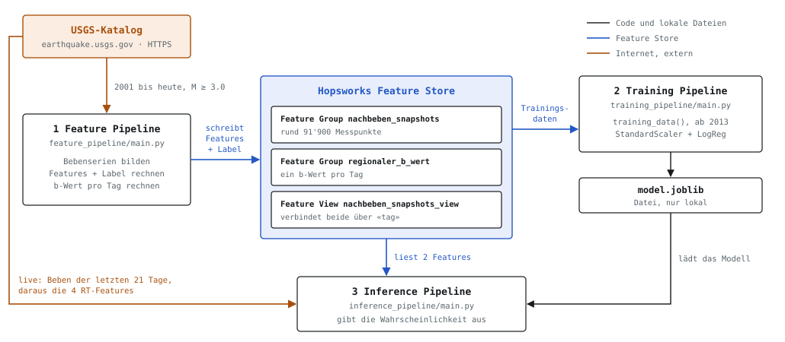

# Projektarbeit CAS AI Operations, FHNW

**Nachbeben-Vorhersage für Japan** · November 2026

**Ziel:** eine saubere FTI-Pipeline mit Feature Store bauen. Die drei Pipelines tauschen Daten nur über den Feature Store aus, nur die Modelldatei liegt lokal. Die Güte des Modells steht dabei nicht im Vordergrund.

**Frage:** Tritt nach einem Hauptbeben (M ≥ 5.0) in Japan in den nächsten 6 Stunden ein Beben ab M 4.5 auf?
**Ausgabe:** eine Wahrscheinlichkeit von 0 bis 100 %.

**Ablauf** (FTI-Architektur: Feature, Training, Inference):

1. **Feature Pipeline:** holt Beben ab M 3.0 vom [USGS-Katalog](https://earthquake.usgs.gov/fdsnws/event/1/)
   (Japan, 2001 bis heute) und fasst sie zu Bebenserien zusammen (Hauptbeben plus Nachbeben). Pro Serie setzt sie
   alle 6 Stunden einen Messpunkt und berechnet 6 Features. Sie schreibt diese in zwei Feature Groups im
   [Hopsworks Feature Store](https://www.hopsworks.ai), verbunden in einer Feature View.
2. **Training Pipeline:** liest die Trainingsdaten aus der Feature View und trainiert eine logistische Regression
   auf dem Label «M 4.5+ in den nächsten 6 h».
3. **Inference Pipeline:** liest die aggregierten Features (kumulative Energie, b-Wert) aus dem Feature Store,
   berechnet die 4 Echtzeit-Features live aus USGS-Daten und gibt mit dem Modell die Wahrscheinlichkeit aus.

Zusätzliche Informationen (Bilder, Begründungen, Quellen): [`docs/zusatzinformationen.html`](docs/zusatzinformationen.html)
(Datei herunterladen und im Browser öffnen).



## Features und Label

Für jede Serie gibt es alle 6 Stunden einen Messpunkt, 14 Tage lang ab dem Hauptbeben. Für das Training liegen alle
6 Features als historische Werte im Store; bei der Vorhersage werden die 4 RT-Features nicht gelesen, sondern live
berechnet.

**Aggregiert** = im Voraus berechnet und im Feature Store gespeichert. **RT** = bei der Vorhersage frisch aus den
aktuellen USGS-Daten berechnet, ohne Vorberechnung (Einschränkung dazu: siehe Limitationen). Beide Arten gehen zusammen in einen
Feature-Vektor (Reihenfolge: `FEATURE_COLUMNS` in `common/config.py`). Das **Label** ist die richtige Antwort
fürs Training und wird bei der Vorhersage nicht verwendet.

| Name | Typ | Bedeutung | Bei der Vorhersage aus |
|---|---|---|---|
| **`kumulative_energie`** | Feature, aggregiert | Summe der Energie aller bisherigen Beben der Serie. Stärkere Beben zählen viel mehr (eine Magnitudenstufe mehr ist etwa 32-mal mehr Energie) | Feature Store |
| **`b_wert`** | Feature, aggregiert | Verhältnis grosser zu kleiner Beben in Japan, letzte 365 Tage (ab M 4.5) | Feature Store |
| **`zeit_seit_letztem_beben_h`** | Feature, RT | Stunden seit dem letzten Beben der Serie | live berechnet |
| **`letzte_magnitude`** | Feature, RT | Stärke des letzten Bebens | live berechnet |
| **`letzte_tiefe_km`** | Feature, RT | Tiefe des letzten Bebens | live berechnet |
| **`anzahl_frueh_nachbeben`** | Feature, RT | Beben ab M 3.0 in der ersten Stunde nach dem Hauptbeben | live berechnet |
| **`label_m45_naechste_6h`** | Label | 1, wenn in den 6 Stunden nach dem Messpunkt ein Beben ab M 4.5 folgt, sonst 0 | nicht verwendet (nur Training) |

**Im Feature Store** liegen zwei Tabellen (Feature Groups): `nachbeben_snapshots` mit einer Zeile pro Serie und
Zeitpunkt (eindeutig über `mainshock_id` + `snapshot_zeit`) und `regionaler_b_wert` mit einem b-Wert pro Tag. Die
Feature View `nachbeben_snapshots_view` verbindet beide über den Tag, sodass jede Zeile alle 6 Features und das
Label enthält. Das Training holt diese Zeilen mit `training_data()`.

| Tabelle | Inhalt | Schlüssel | Zeitfeld (event_time) |
|---|---|---|---|
| Feature Group `nachbeben_snapshots` | eine Zeile pro Serie und Messpunkt: 5 Features, Label, `ist_demo_reserve`, `tag` | `mainshock_id` + `snapshot_zeit` | `snapshot_zeit` |
| Feature Group `regionaler_b_wert` | ein b-Wert pro Tag (`b_wert`, `n_ereignisse`) | `tag` | `tag` |
| Feature View `nachbeben_snapshots_view` | verbindet beide über `tag`: 6 Features und Label pro Zeile | – | – |

Die Inferenz liest dieselbe View mit `get_batch_data()`. `snapshot_zeit` muss Teil des Schlüssels sein, sonst
überschreiben sich die Zeilen einer Serie (Kontrolle: rund 91'900 Zeilen nach dem Schreiben).

## Ausführung

**Voraussetzungen:** Conda; Python **3.12**; ein kostenloses Konto auf [hopsworks.ai](https://www.hopsworks.ai) mit einem
Projekt und einem API-Key (wird in die Datei `.env` eingetragen, bleibt lokal und wird nicht hochgeladen).
Die Pakete mit festen Versionen stehen in `requirements.txt` (u. a. hopsworks, pandas,
scikit-learn).

```
conda create --prefix ./.condaenv python=3.12
conda activate ./.condaenv
pip install -r requirements.txt
cp .env.example .env      # HOPSWORKS_API_KEY und HOPSWORKS_PROJECT_NAME eintragen
```

**Die Befehle in dieser Reihenfolge ausführen, jeweils aus dem obersten Ordner des Repos:**

```
python feature_pipeline/main.py                   # 1. Daten holen, Features rechnen, in den Store schreiben
python training_pipeline/main.py                  # 2. Modell trainieren und lokal speichern
python inference_pipeline/main.py --mode live     # 3a. Modus live: aktuelle Vorhersage
python inference_pipeline/main.py --mode replay --mainshock-id us20005iis --6h-fenster-start-nach-hauptbeben 0   # 3b. Modus replay
```

- **Zwei Modi.** *live* nimmt das neueste echte Hauptbeben der letzten 21 Tage. *replay* spielt ein vergangenes
  Demo-Beben nach (Kumamoto `us20005iis`, Fukushima/Namie `us10007b88`, Hokkaido-Iburi `us2000h8ty`); diese drei
  liegen im Store, kommen aber nie ins Training. Im Replay wird die Energie live für den gewählten Zeitpunkt
  nachgerechnet, der b-Wert kommt aus dem Store. Im Live-Modus kommen beide aus dem Store.
- **Nach Schritt 1 kurz warten.** Die Feature Pipeline startet am Ende zwei Hopsworks-Jobs
  (`..._offline_fg_materialization`). Das Training liest erst vollständige Daten, wenn beide fertig sind. Es zeigt beim Start, wie
  viele Zeilen es geladen hat (beim Lauf vom 09.11.2026: «91857 Zeilen geladen»). Ist die Zahl deutlich kleiner
  oder bricht das Training mit «No hudi commits found» ab, sind die Jobs noch nicht fertig: einige Minuten warten
  und das Training neu starten.
- **Das Modell liegt nicht im Repo.** Vor der Inferenz muss das Training einmal gelaufen sein. Es wird nur lokal
  gespeichert (`training_pipeline/output/model.joblib`), eine Model Registry wird nicht benutzt.
- **Hinweis:** Die Ausgabe erscheint im Terminal. Die Warnung zur Hopsworks-Version beim Start ist harmlos.

**Testlauf vom 09.11.2026** (alle Schritte in diesem Repo, in der Reihenfolge oben):

| Schritt | Ergebnis |
|---|---|
| 1. Feature Pipeline | 32'662 Beben, 1615 Serien, 91'857 Messpunkte und 5061 b-Werte in den Feature Store geschrieben |
| 2. Training | 91'857 Zeilen über die Feature View geladen; Training mit 49'615 Zeilen aus 874 Serien (924 «Ja»); ROC-AUC 0.747 |
| 3a. Live | Serie `us7000tx1f`: 2.88 % |
| 3b. Replay Kumamoto 2016 (`us20005iis`) | 14.21 %, tatsächlich Ja (M 5.1 nach 0.1 h) |
| 3b. Replay Fukushima/Namie 2016 (`us10007b88`) | 12.74 %, tatsächlich Ja (M 5.0 nach 0.1 h) |
| 3b. Replay Hokkaido-Iburi 2018 (`us2000h8ty`) | 9.00 %, tatsächlich Ja (M 5.3 nach 0.2 h) |

## Daten und Modell

- **Daten:** 1615 Serien, rund 91'900 Messpunkte im Store. Serienregel (`common/decluster.py`): Nur ein Beben ab
  M 5.0 startet eine neue Serie; ein Beben gehört zur Serie, wenn es höchstens 100 km und 14 Tage nach dem letzten
  Beben der Serie liegt. Training: nur Daten ab 2013, weil der b-Wert in den USGS-Daten davor einen Sprung hat (Ursache
  unbekannt). Die 3 Demo-Beben sind ausgeschlossen, sie dienen dem Replay. Übrig bleiben rund 49'600 Zeilen aus 874
  Serien, bei 1.9 % davon folgte ein Beben ab M 4.5.
- **Modell:** Logistische Regression (`scikit-learn`) mit `StandardScaler`. 80 % der Serien zum Trainieren, 20 % zum
  Prüfen (geteilt nach Serien, nicht nach Zeilen).
- **Ergebnis (Lauf vom 09.11.2026):** ROC-AUC 0.747 (0.5 = Raten, 1.0 = perfekt). Das Modell ordnet die Gefahr
  sinnvoll, schätzt sie aber zu tief ein: Bei den drei Demo-Beben gab es 9–14 %, obwohl jedes Mal kurz darauf ein
  Beben ab M 4.5 folgte.

## Struktur des Codes

Um Training/Serving-Skew zu verhindern, liegt die Feature-Berechnung nur einmal in `common/` und wird von der
Feature Pipeline und der Inference Pipeline gemeinsam genutzt. Die Pipelines importieren sich nicht gegenseitig und
tauschen Daten nur über den Feature Store aus (Ausnahme: `model.joblib`).

```
CAS_Projektarbeit_MLOPs/
├── README.md                    diese Beschreibung
├── requirements.txt             Python-Pakete mit festen Versionen
├── .env.example                 Vorlage für .env (Hopsworks-API-Key, Projektname)
├── common/                      gemeinsamer Code, läuft nie allein
│   ├── config.py                Zahlen und Schwellen (M 5.0, 6 h, 14 Tage …), FEATURE_COLUMNS
│   ├── usgs.py                  Beben bei USGS abholen
│   ├── decluster.py             Beben zu Bebenserien gruppieren
│   ├── features.py              Features und Label rechnen
│   └── hopsworks_io.py          Feature Store lesen und schreiben
├── feature_pipeline/main.py     nutzt: config, usgs, decluster, features, hopsworks_io (schreibt)
├── training_pipeline/main.py    nutzt: config, hopsworks_io (liest über die Feature View)
├── inference_pipeline/main.py   nutzt: config, usgs, decluster, features, hopsworks_io (liest über die Feature View)
├── tests/check_b_wert_join.py   prüft, ob der b-Wert dem richtigen Tag zugeordnet ist
└── docs/
    ├── architektur.svg          Architektur-Bild (oben im README)
    └── zusatzinformationen.html Bilder, Begründungen, Quellen
```

## Limitationen

**Hinweis zu den Features:** Die zwei Features aus dem Store bringen dem Modell wenig.
- **`kumulative_energie`:** Die Energie einer Serie stammt fast nur vom Hauptbeben (im Median 96 %). Das Feature misst
  also kaum mehr als die Stärke des Hauptbebens.
- **`b_wert`:** Es gibt nur einen Wert pro Tag für ganz Japan, und er ändert sich von Tag zu Tag kaum. Er unterscheidet
  die einzelnen Serien darum nicht. In einem Vergleichslauf mit gleichen Daten lag die ROC-AUC mit b-Wert bei 0.769, ohne bei 0.770.

Die Wahl besserer Features wäre eine Aufgabe für Data Science. Der MLOps-Teil, also Pipelines, Feature Store und
Ablauf, funktioniert wie beschrieben.

Bekannte Einschränkungen:

1. **Neues Hauptbeben:** Ist ein Hauptbeben neu, gibt es dafür noch keine Daten im Feature Store. Der Live-Modus bricht dann mit einer klaren Meldung ab. Zuerst muss die Feature Pipeline laufen, danach funktioniert die Vorhersage.
2. **Aktualität:** Im Live-Modus kommen Energie und b-Wert aus dem letzten Lauf der Feature Pipeline und können darum etwas veraltet sein. Die vier RT-Werte sind immer aktuell. Die Vorhersage wird dadurch kaum schlechter, weil die zwei Features ohnehin wenig beitragen (siehe Hinweis oben).
3. **Alte Serie im Live-Modus:** Der Live-Modus nimmt das neueste Beben ab M 5.0 der letzten 21 Tage. War es vor mehr als 14 Tagen, liegt es ausserhalb des Zeitraums, den das Modell gelernt hat. Eine Warnung gibt es nicht.
4. **Alles wird neu berechnet:** Bei jedem Lauf holt die Feature Pipeline alle Beben seit 2001 neu und ersetzt die Daten im Feature Store komplett. Vorteil: Spätere Korrekturen von USGS an alten Beben werden automatisch übernommen. Nachteil: Jeder Lauf dauert einige Minuten.
5. **Was «RT» hier heisst:** Alle vier RT-Features werden bei der Vorhersage live berechnet. Wirklich erst in diesem Moment bekannt ist aber nur `zeit_seit_letztem_beben_h`, weil es von der aktuellen Uhrzeit abhängt. Die anderen drei beschreiben vergangene Beben und könnten auch vorab im Store liegen.
6. **Einfache Serienregel:** Ein Beben gehört zur Serie, wenn es höchstens 100 km und 14 Tage nach dem letzten Beben kommt, unabhängig von der Stärke. Fachverfahren vergrössern dieses Fenster bei starken Beben.
7. **Lücken bei kleinen Beben:** USGS erfasst Beben unter M 4.5 nicht vollständig, vor allem direkt nach starken Beben. Darum gilt das Label erst ab M 4.5. `anzahl_frueh_nachbeben` (ab M 3.0) ist davon betroffen.
8. **Training erst ab 2013:** Der b-Wert springt in den Daten vor 2012, Grund unbekannt. Darum trainiert das Modell nur mit Daten ab 2013. Der Sprung wurde erst spät bemerkt; die Feature Pipeline lädt deshalb weiterhin alle Beben ab 2001, auch wenn das Training sie nicht nutzt.
9. **Seltene «Ja»-Fälle:** Nur bei 1.9 % der Messpunkte folgt ein Beben ab M 4.5. Das Modell gibt darum fast immer weniger als 50 % aus. Die Zahl ist als Vergleich zu lesen: Ein höherer Wert heisst höhere Gefahr, nicht «wahrscheinlich kommt ein Beben».
10. **Starke Beben unterschätzt:** Bei den drei Demo-Beben gab das Modell 9–14 %, obwohl jedes Mal kurz darauf ein Beben ab M 4.5 folgte. Vermutlich, weil im Training nur wenige starke Serien vorkommen (8 mit M 7 oder mehr).
11. **Nur eine Aufteilung geprüft:** Das Modell wurde mit einer einzigen Aufteilung geprüft (80 % Training, 20 % Prüfung). Das Ergebnis hängt davon ab, welche Serien zufällig in der Prüfung landen; frühere Läufe mit leicht anderen Daten und anderer Aufteilung ergaben 0.756 und 0.769 statt 0.747. Eine Kreuzvalidierung (mehrere Aufteilungen, Mittelwert) wäre zuverlässiger, wurde aber nicht gemacht, weil die Modellgüte nicht im Vordergrund steht.
12. **Lesen über die Feature View statt Online Store:** Die Inferenz liest die neuesten Werte über die Feature View aus dem Offline Store. Für die vorhandene Datenmenge (rund 91'900 Zeilen) reicht das. Bei grösseren Datenmengen oder sehr schnellen Abfragen wäre ein Online Store die passende Erweiterung.
13. **Hauptbeben erst im Nachhinein bekannt:** Im Training ist das stärkste Beben einer Serie schon bekannt. Live kennt man nur die Beben bis jetzt; kommt später ein stärkeres, wird es rückwirkend zum Hauptbeben (Beispiel Kumamoto 2016).
